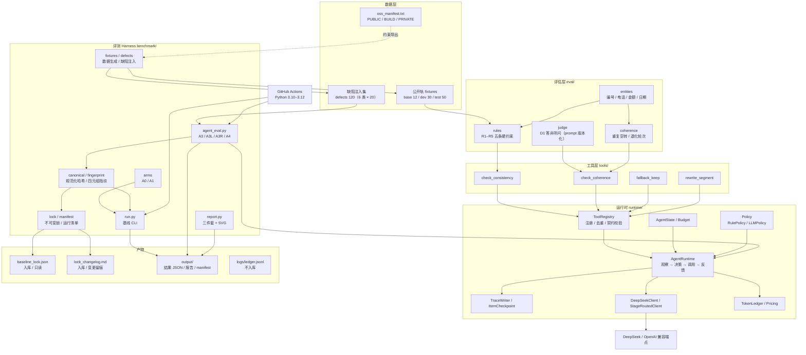
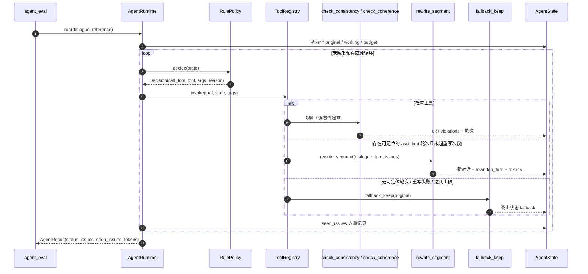
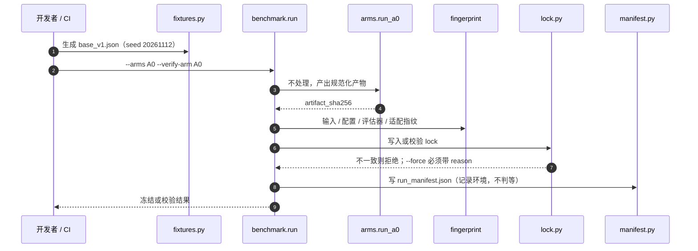

# 架构设计

> 版本：v1.0  
> 最后修订：2026-11-18  
> 事实基线：Sprint 1a（`24de810`）之后的仓库代码；文档与代码冲突时以代码与测试为准  
> 关联文档：[Benchmark评测设计](Benchmark评测设计.md)、[模块与接口说明](模块与接口说明.md)、[决策记录ADR](../decisions/决策记录ADR.md)、[改造路线图](../decisions/改造路线图.md)、[部署与运行指南](../guides/部署与运行指南.md)

## 1. 文档定位

本文回答四个问题：

1. 系统由哪些部分组成，边界在哪里；
2. 各模块之间如何协作，核心流程怎么走；
3. 为什么选择这些技术，放弃了什么；
4. 在可复现性、可靠性、安全、成本、可观测性上做了什么，哪些仍是设计目标。

本文只描述**当前仓库中可验证的能力**。未实现部分统一标注为“设计目标（未实现）”或“已移出范围”，不把规划写成现状。

## 2. 设计目标与非目标

### 2.1 设计目标

| 目标 | 可验证的落地方式 |
|---|---|
| 用 Agent 修复模板拼接对话的跨轮断裂 | `check_*` 工具 + `rewrite_segment` + `fallback_keep` 组成的可回退修复循环 |
| 结论可复现、可归因 | 四元组指纹 + 不可变 `baseline_lock.json` + 单变量对照臂 + CI 复现 |
| 改坏了能被拦住 | 五条硬约束（R1–R5）与连贯性检查先于接受；硬门禁优先于胜率 |
| 成本说得清 | append-only token ledger + 版本化价格表 + 缓存命中成本归零 |
| 开源可独立运行 | 公开轨程序化数据 + `oss_manifest.txt` 导出边界 + 边界自证测试 |

### 2.2 非目标

| 非目标 | 原因与现状 |
|---|---|
| 多 Agent / 多专家协作 | 当前工具集与任务规模不需要；见 ADR D3，暂不引入 |
| RAG 检索增强 | 已移出本期，仅保留 `A5-RAG` 臂的占位命名；见 ADR D5 |
| LangChain / LangGraph 等框架 | 自研注册表与状态机已满足需求，引入框架会增加抽象与调试成本；见 ADR D2 |
| 服务化 / Docker / MCP / OTel | 属路线图 S2，当前只提供本地 Python CLI |
| L3 效果层统计闭环 | 属路线图 S1b，当前未实现胜率区间、McNemar、双盲 judge 等统计 |

## 3. 整体架构

### 3.1 分层架构图



### 3.2 分层职责

| 层 | 职责 | 不负责 |
|---|---|---|
| 数据层 | 提供公开轨对话与程序化缺陷注入，保证同 seed 同产物 | 真实业务数据（不在本仓库） |
| 评估层 | 把“连贯/保真”拆成可判定的规则与判官 | 决定改不改、怎么改 |
| 工具层 | 以统一契约暴露检查、重写、回退能力 | 维护循环状态、做预算决策 |
| 运行时 | 注册工具、维护状态、执行策略循环、记录 Trace 与 token | 定义指标口径 |
| 评测 Harness | 生成数据、装配对照臂、锁定基线、产出报告 | 修改运行时语义 |
| 产物层 | 冻结基线、留存运行清单、输出报告 | 被静默覆盖 |

## 4. 模块划分

| 路径 | 职责 | 关键入口 | 状态 |
|---|---|---|---|
| `agent/benchmark/canonical.py` | 规范化 JSON 序列化与 sha256 | `canonical_bytes` / `sha256_*` | 已实现 |
| `agent/benchmark/fingerprint.py` | 四元组指纹（输入/配置/评估器/适配） | `build_fingerprint` | 已实现 |
| `agent/benchmark/lock.py` | 不可变基线锁、校验、`--force` 留痕 | `write_lock` / `verify_lock` | 已实现 |
| `agent/benchmark/manifest.py` | 运行清单（环境/命令/产物哈希），不参与判等 | `build_manifest` | 已实现 |
| `agent/benchmark/arms.py` | A0 恒等臂、A1 上游增强臂 | `run_a0` / `run_a1` | A0 已实现；A1 需主工程上游步骤 |
| `agent/benchmark/fixtures.py` | 公开轨数据生成与 dev/test 分层切分 | `main` / `split_dialogues` | 已实现 |
| `agent/benchmark/defects.py` | 六类缺陷程序化注入 | `main` / 注入函数 | 已实现 |
| `agent/benchmark/run.py` | 基线 CLI（A0/A1、lock 校验） | `main` | 已实现 |
| `agent/benchmark/agent_eval.py` | Agent 臂评测 CLI（A3/A3L/A3R/A4） | `main` / 臂装配 | 已实现 |
| `agent/benchmark/report.py` | 报告生成（JSON/MD/HTML + SVG） | `main` | 已实现 |
| `agent/runtime/registry.py` | 工具注册表与函数工具适配 | `ToolRegistry` / `FunctionTool` | 已实现 |
| `agent/runtime/state.py` | 单条对话的运行时状态 | `AgentState` | 已实现 |
| `agent/runtime/budget.py` | 轮次/工具调用/token/墙钟预算 | `Budget` / `BudgetTracker` | 已实现 |
| `agent/runtime/policy.py` | 规则策略与 LLM function calling 策略 | `RulePolicy` / `LLMPolicy` | 已实现 |
| `agent/runtime/loop.py` | 决策循环、终止原因、死循环保护 | `AgentRuntime.run` | 已实现 |
| `agent/runtime/trace.py` | JSONL 决策链与 token 账本 | `TraceWriter` / `TokenLedger` | 已实现 |
| `agent/runtime/checkpoint.py` | 条目级断点续跑 | `ItemCheckpoint` | 类已实现；批量评测接入属 S1b |
| `agent/runtime/config.py` | `.env` 读取与 `LLMSettings` | `load_settings` | 已实现 |
| `agent/runtime/deepseek.py` | DeepSeek 客户端、重试分类、缓存、分侧路由 | `DeepSeekClient` / `StageRoutedClient` | 已实现 |
| `agent/runtime/pricing.py` | 版本化价格表与成本折算 | 价格表常量 | 已实现 |
| `agent/eval/rules.py` | R1–R5 五条硬约束 | `check_rules` | 已实现 |
| `agent/eval/coherence.py` | C1–C3 连贯性检查（判官可注入） | `check_coherence` | 已实现 |
| `agent/eval/judge.py` | D1 语义判官，prompt 版本化 | `SemanticJudge` | 已实现 |
| `agent/eval/entities.py` | 领域无关实体抽取 | `extract_entities` | 已实现 |
| `agent/tools/check_consistency.py` | 改写前后一致性校验工具 | `make_check_consistency` | 已实现 |
| `agent/tools/check_coherence.py` | 对话连贯性检查工具 | `make_check_coherence` | 已实现 |
| `agent/tools/fallback_keep.py` | 放弃改写、保留原文的终止工具 | `make_fallback_keep` | 已实现 |
| `agent/tools/rewrite_segment.py` | 定位并重写指定轮次 | `make_rewrite_segment` / `rewrite_turn` | 已实现（A3R 专用） |
| `agent/benchmark/baseline/` | 冻结基线真源 | `baseline_lock.json` / `lock_changelog.md` | 已实现 |
| `agent/tests/` | 单元/契约/集成/快照/开源边界 | `python -m pytest` | 已实现 |

> `agent/plugin/`（主工程胶水层）不在本仓库：它依赖上游 `PipelineStep`，只在主工程内部使用。

## 5. 核心交互流程

### 5.1 可回退修复循环（A3R）



关键约束：

- `rewrite_segment` **不在默认工具集**中，只在 A3R 臂按需注册；默认 A3/A3L/A4 不具备修复能力。
- 重写后必须再次经过一致性/连贯性检查；检查不过则回退原文。
- 同一问题重复出现会进入 `seen_issues`，避免“检查—重写—再检查”无限循环。
- 预算触顶、死循环、工具终止、异常分别映射为不同的终止原因，避免把“没检出”与“被环境打断”混为一谈。

### 5.2 基线冻结与复现



- `baseline_lock.json` 只存**可判等**的指纹；`run_manifest.json` 存 git commit、宿主环境、命令与产物哈希，用于**溯源**，不参与判等。
- `--verify-arm A0` 不读取被测输入里的 `artifact_sha256` 做自证，而是独立重跑后比对，防止“输入自带答案”。

### 5.3 消融评测

```text
fixtures/public/{base,dev,test}_v1.json
        │
        ├─ A3  规则决策 + 确定性工具
        ├─ A3L LLM 决策 + 确定性工具
        ├─ A3R 规则决策 + 确定性工具 + rewrite_segment
        └─ A4  LLM 决策 + 确定性工具 + 语义判官
                │
                ├─ 每条样本：AgentRuntime → Trace / token 增量
                ├─ 汇总：detected / blocked / stopped / false_positive / tokens / cost
                └─ 产物：<arm>_<timestamp>.json + 同目录 run_manifest.json
                        │
                        └─ report.py → benchmark_report.{json,md,html} + figures/*.svg
```

评测口径以 [Benchmark评测设计](Benchmark评测设计.md) 为准：失败样本计入分母，`stopped` 与“未检出”分开统计，硬门禁先于胜率。

## 6. 关键机制

### 6.1 四元组指纹与不可变锁

```text
基线 = ⟨输入指纹, 配置指纹, 评估器指纹, 适配指纹⟩
```

| 指纹 | 内容 | 防止什么 |
|---|---|---|
| 输入 | 内容 sha256、样本数、抽样键 sha256、seed、分层维度 | 换了数据还叫复现 |
| 配置 | 剥离易变键后的配置哈希、prompt/policy/模型/价格表版本 | 改了参数不自知 |
| 评估器 | 规则版本、judge prompt 版本与源码哈希、rubric 版本、温度 | 换尺子量新旧结果 |
| 适配 | `adapter_version`、`canonical_schema_version`、域配置哈希 | 同一文件、不同形态 |

- lock 一经生成不可覆盖；确需变更必须 `--force --reason`，并自动追加到 `lock_changelog.md`。
- 校验时忽略 `generated_at` 与代码状态等易变字段；工作区 dirty 默认拒绝冻结。
- 当前没有独立 adapter 实现，适配指纹记录的是 schema 与域配置元数据（见“实现边界”）。

### 6.2 单变量消融

每个相邻臂只差一个变量，否则不出结论：

| 对比 | 唯一变量 | 可归因结论 | 状态 |
|---|---|---|---|
| A1 vs A0 | 是否做规则增强 | 现有增强是否有增量 | A1 需主工程 |
| A2 vs A1 | 是否引入单次 LLM 重写 | LLM 重写本身的净收益 | A2 未实现（S1b） |
| A3 vs A2 | 是否有“检查→校验→回退”闭环 | 工具循环净收益（主结论） | A2 缺失，暂不可比 |
| A3R vs A3 | 是否有“定位→重写→复检” | 修复工具相对只回退的净收益 | A3R 已实现，L3 复测待 S1b |
| A3L vs A3 | 决策者由规则换成 LLM | 自主决策净收益 | 已实现并测过 |
| A4 vs A3L | 是否加入语义判官 | 判官净收益 | 已实现并测过 |

### 6.3 状态与指标口径

| 状态 / 字段 | 含义 | 使用位置 |
|---|---|---|
| `accepted` | 检查通过，接受当前对话 | `AgentResult.status` |
| `fallback` | 放弃改写，保留原文 | `AgentResult.status` |
| `stopped` | 因预算、死循环或终止工具提前停止 | `AgentResult.status` / 评测 `stopped` |
| `failed` | 工具或策略异常，未能完成 | `AgentResult.status` |
| `detected` | 评测侧：缺陷类型被检出 | 臂结果统计 |
| `blocked` | 评测侧：检出且处理成功（回退或修复） | 臂结果统计 |
| `false_positive` | 干净样本被标记为有问题 | 臂结果统计 |

`stopped` 必须单列，不能混入“模型没检出”；这是 A4 实测中一次宿主机待机事件暴露出的口径问题。

### 6.4 预算、死循环与回退

| 机制 | 实现 | 默认值 |
|---|---|---|
| 轮次上限 | `Budget.max_iterations` | 3（A3R 覆盖为 20） |
| 工具调用上限 | `Budget.max_tool_calls` | 6（A3R 覆盖为 24） |
| token 上限 | `Budget.max_tokens` | 6000（A3R 覆盖为 20000） |
| 墙钟预算 | `Budget.max_wall_clock_s` | 120s（A3R 覆盖为 300s） |
| 相同调用重复 | `MAX_REPEAT_SAME_CALL = 2` | 超过即判定死循环 |
| 兜底 | `fallback_keep` | 任何无法安全修复的情况保留原文 |

### 6.5 token 计量与成本

- `TokenLedger` 为 append-only JSONL：每次模型调用记录 stage、model、in/out tokens、latency、cached、cache_hit_tokens、成本。
- 缓存命中行成本归零，但仍保留 token 数，避免“缓存把用量洗没”。
- 价格表按版本维护；成本折算使用同一价格表版本，版本号进入 lock。
- 失败调用同样记账，不因异常丢失用量。

## 7. 技术选型

| 领域 | 选择 | 理由 | 放弃的方案 |
|---|---|---|---|
| 语言 | Python ≥ 3.10 | 类型标注、`dataclass`、团队现有栈 | — |
| 核心依赖 | 标准库优先 | 离线可跑、CI 稳定、减少供应链风险 | 重量级编排框架 |
| 在线调用 | `httpx` + `tenacity`（`[llm]` 可选依赖） | 超时/重试可控，兼容 OpenAI 协议 | 各家 SDK 绑定 |
| Agent 运行时 | 自研 `ToolRegistry` + `Policy` + `AgentRuntime` | 契约小、可测试、Trace 字段可控 | LangChain / LangGraph（ADR D2） |
| 模型接入 | DeepSeek OpenAI 兼容端点 | 成本低、支持 function calling、可替换 `base_url` | 单一厂商 SDK |
| 双侧模型 | `generate` / `judge` 分侧路由 | 降低自我偏好；可分别换模型 | 单一模型包办 |
| 数据格式 | JSON / JSONL | 人类可读、diff 友好、无需数据库 | 向量库 / 数据库（RAG 已移出） |
| 哈希 | 规范化 JSON + sha256 | 唯一哈希入口，跨平台稳定 | 直接哈希原始字节 |
| 测试 | pytest | 生态成熟、CI 简单 | unittest |
| CI | GitHub Actions + uv | 3.10–3.12 矩阵、依赖锁定 | 仅本地测试 |
| 文档 | Markdown + Mermaid | 与代码同仓、可评审、无需构建 | 独立文档站 |

## 8. 非功能性设计

### 8.1 可复现性（已实现）

- 数据生成固定 seed；同 seed 产物字节一致。
- 规范化序列化保证哈希与平台无关；`baseline_lock.json` 不可静默覆盖。
- lock 校验忽略 `generated_at` 与 `code.dirty` 等易变字段。
- CI 在 Python 3.10/3.11/3.12 上重复执行 A0 复现命令。
- 在线评测只能保证“同指纹”；模型输出的逐字节复现不在承诺范围内。

### 8.2 可靠性（已实现）

- 仅对传输错误、429、5xx 做有界重试；解析错误与业务拒绝不重试。
- 决策循环有轮次、工具调用、token、墙钟四重预算。
- 相同工具调用重复超过阈值即判定死循环并停止。
- 任何检查失败或无法安全修复的路径都收敛到 `fallback_keep`，不输出半成品。

### 8.3 安全与合规（已实现）

- API key 只从环境变量读取，不写入仓库、lock 或报告。
- 公开轨数据全部程序化合成，不含业务标识；`oss_manifest.txt` 与边界测试阻止私有文件外泄。
- 私有轨数据只存在于主工程，不随仓库分发。
- Trace / ledger 记录 prompt 与响应摘要；生产使用时应按内部规范脱敏。

### 8.4 成本（已实现）

- append-only ledger 记录每次调用，失败与缓存命中同样留痕。
- 价格表版本化；报告中成本必须注明价格表版本与单价口径。
- 缓存命中成本归零，避免重复运行被重复计费。

### 8.5 可观测性（部分实现）

- 已实现：JSONL Trace（决策、工具结果、终止原因）、token ledger、运行 manifest。
- 设计目标（未实现）：OpenTelemetry 指标与链路、集中式日志、成本看板（路线图 S2）。

### 8.6 性能（设计目标）

| 指标 | 目标 | 现状 |
|---|---|---|
| A3 单条 P95 延迟 | ≤ 20s | 有墙钟预算，未做分位统计 |
| A4 单条 P95 延迟 | ≤ 60s | 同上 |
| 重复运行缓存命中率 | ≥ 90% | 进程内缓存；跨进程未持久化 |
| 并发吞吐 | 非本期目标 | 逐条串行 |

### 8.7 可维护性（已实现）

- 单元/契约/集成/快照/边界测试分层；所有不变量有对应测试。
- `canonical.py` 是唯一哈希入口，避免多处实现漂移。
- 文档按“架构 / 决策 / 指南 / 归档”分层，指标与契约各自单一事实源。

## 9. 当前实现边界

| 能力 | 状态 | 说明 |
|---|---|---|
| A0 / A1 对照臂 | 部分实现 | A0 可独立跑；A1 依赖主工程上游增强步骤 |
| A2 单次重写臂 | 未实现 | 路线图 S1b；因此“A3 vs A2”的主结论暂不可得 |
| A3 / A3L / A4 | 已实现 | `agent_eval` 可运行；A4 需在线密钥 |
| A3R 修复臂 | 已实现 | 已接入 `rewrite_segment` 与多轮预算；L3 统一复测待 S1b |
| L3 效果层统计 | 未实现 | 胜率区间、McNemar、双盲 judge、人工校准未接入 |
| replay / cassette | 未实现 | 路线图 S1b |
| checkpoint 批量接入 | 部分实现 | 类已存在，评测循环未默认启用 |
| adapter 适配层 | 部分实现 | 字段契约与指纹存在，独立 adapter 模块未落地 |
| 私有轨 | 不在本仓库 | 仅主工程内部使用 |
| Docker / MCP / OTel | 未实现 | 路线图 S2 |
| RAG | 已移出范围 | 仅保留 `A5-RAG` 命名占位 |

## 10. 关联文档

- 指标与统计口径：[Benchmark评测设计](Benchmark评测设计.md)
- 工具、运行时、CLI 与产物字段：[模块与接口说明](模块与接口说明.md)
- 取舍理由与面试防守：[决策记录ADR](../decisions/决策记录ADR.md)
- Sprint 顺序与完成状态：[改造路线图](../decisions/改造路线图.md)
- 安装、运行与排障：[部署与运行指南](../guides/部署与运行指南.md)
